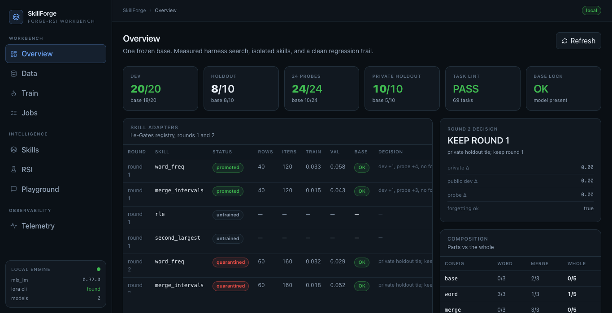

# Forge-RSI

**A local continual-learning engine for a frozen model, with the SkillForge workbench.**

Forge-RSI is the project and the engine: recursive harness search, Le-Gates skill
isolation, gap mining, Dream policy replay, and private-holdout rotation.
**SkillForge** is the local workbench and data/training pipeline inside it:
curate real data, train isolated adapters, inspect every measurement, and queue
the long chains behind human gates.

The base model stays frozen and byte-identical the whole time.



## Naming

| Name | What it is |
|---|---|
| **Forge-RSI** | The project and the engine (`forge_rsi/`): harness loop, Le-Gates, gaps, Dream, holdouts |
| **SkillForge** | The workbench UI and data/training pipeline (`ui/`, `pipeline/`): data, train, jobs, playground, telemetry |

The repository is `github.com/d4vid-le/Forge-RSI`.

## The SkillForge workbench

| View | What it does |
|---|---|
| **Overview** | Base lock, skill registry, gated evaluations, RSI rounds, composition, reports |
| **Data** | Import → clean → review → accept/reject/edit → export through hard gates |
| **Train** | Real `mlx_lm.lora` training: dataset prep, LoRA config, exact command preview, live loss/log |
| **Jobs** | Guarded queue: skill, gap, RSI, Dream, and holdout-rotation chains with a human gate |
| **Skills** | Le-Gates adapters: rank-8 deltas on the frozen base, one gate at a time, quarantine-first |
| **RSI** | Harness proposals, pairwise accept/reject, holdout guards, Dream replay, gap clusters |
| **Playground** | Real local chat and robustness probe against `mlx_lm.server` or Ollama |
| **Telemetry** | Runs, evaluations, base-lock state, and generated reports |

Nothing here is a mock. If a server or model is missing, the UI says so instead of
inventing a token, a loss, or a score.

## Quick start

Requirements: macOS on Apple Silicon, Python 3.11+, MLX, and a local model.
The UI is prebuilt in `ui/dist`; Node is only needed to edit it.

```bash
python -m venv .venv
source .venv/bin/activate
pip install -e '.[dashboard]'

cp config.example.toml config.toml
mkdir -p models
ln -s /absolute/path/to/MiMo-v2.6-distill-qwen-9b-mlx  models/MiMo-v2.6-distill-qwen-9b-mlx
ln -s /absolute/path/to/Qwen3.6-35B-A3B-MLX-8bit       models/Qwen3.6-35B-A3B-MLX-8bit
```

Run the workbench under the MLX environment. `PYTHON` selects the interpreter,
`PATH` makes `mlx_lm.lora` / `mlx_lm.server` discoverable, and
`FORGE_RSI_LABS` adds model directories outside the Hugging Face cache
(`SKILLFORGE_LABS` is still accepted for compatibility):

```bash
PYTHON=/path/to/mlx-env/bin/python \
PATH=/path/to/mlx-env/bin:$PATH \
FORGE_RSI_LABS=/absolute/path/to/MiMo-v2.6-distill-qwen-9b-mlx \
./sf serve
# http://127.0.0.1:8010
```

The React UI is served at `/`; the classic single-file UI remains at `/classic`.
The standalone read-only Ops dashboard is still available:

```bash
python -m forge_rsi dashboard
# http://127.0.0.1:8765
```

### Edit the UI

```bash
npm --prefix ui install
npm --prefix ui run dev      # http://127.0.0.1:5173, /api proxied to :8010
npm --prefix ui run build    # writes ui/dist, served by ./sf serve
```

### Tests

Deterministic stdlib checks for the Forge log parser, the guarded queue, gap
mining, Dream replay, and holdout rotation (no model, no network):

```bash
python -m unittest discover -s tests
```

## The loop

```
Data → Train → Skills → RSI → Playground → Telemetry
                    Jobs orchestrates and gates the long chains
```

- **Data**: import raw JSON/JSONL, clean, review, export. The export gate refuses
  secrets, host paths, invalid tool JSON, orphan observations, and oversize rows.
- **Train**: prepare train/valid, preview the exact `mlx_lm.lora` argv, run it,
  poll real loss/log. The base is frozen; the adapter is a candidate.
- **Skills (Le-Gates)**: one rank-8 adapter per skill, trained fresh from the
  base on a pure corpus, selected by a hard 0/1 router with `Σ gate ≤ 1`.
  A bad skill is quarantined (gate 0), never deleted.
- **RSI**: the teacher proposes a harness, the loop runs the frozen tasks,
  compares task-by-task, and keeps the candidate only if it wins, stays near the
  cost ceiling, and passes the anti-leak validator. Ties keep the incumbent.
- **Jobs**: queue an explicit chain — skill round, gap round, RSI round, Dream
  round, or holdout rotation. The API accepts only allowlisted parameters,
  records the exact argv, streams the child's output, and stops at a human gate
  before promotion or holdout replacement. Training steps check the base lock
  first; a mismatch fails the job before any weights are touched.
- **Gaps**: group measured failures by skill, then mine only *re-verified*
  passing traces into a raw corpus. Public and private holdouts are excluded.
- **Dream**: collect K candidates on a dev run, then replay selection policies
  offline over the cached candidates. The oracle is an upper bound, never shipped.
- **Holdout rotation**: generate a fresh private set from deterministic
  templates, verify every reference, archive the previous set, and publish only
  counts/hashes. The prompts and hidden tests stay local.
- **Playground**: chat and probe a real local server; no server, no reply.
- **H2 research**: the frozen [pre-registration](docs/H2-PREREG-v2.md) ran a
  staged parallel propose–probe–compose experiment on `dev_hard`. Stage 1
  stopped: **B 17/20 vs A 16/20 (+1, p=1.0, CI [-0.10,+0.20])**, below the +3
  floor. The composer selected one candidate instead of synthesizing; the cue
  table had zero routing entropy. The greedy compute control was stopped by the
  duplicate rule and is **invalid**, not a compute-matched comparison. Stage 2
  and the experience-library arms were not run, per the stop rule. See
  [`reports/h2_stage1.md`](reports/h2_stage1.md).
- **Telemetry**: every run, evaluation, and report is read from disk.

The next automation work is scheduling/triggering the chains, teacher-authored
repairs for gaps with no verified pass, and a composition controller after
offline validation. Promotion still requires a human at the gate.

## Measured state

| | Result |
|---|---|
| Dev | 20/20 gated (base 18/20) |
| Holdout | 8/10 (unchanged, public regression guard) |
| 24 held-out skill probes | 24/24 gated (base 10/24) |
| Private holdout | 10/10 gated (base 5/10), withheld |
| Round 2 | tied the blind holdout; kept round 1 |
| RSI | r1 rejected repeated `run_tests`; r1b accepted `nonstub_retry` |
| Composition | parts work; the compound whole does not |
| Dream replay | `test_gated` 10/12 vs `first` 9/12 on 12 probes × 3 samples |
| Gap mining | 14 failing probes → 28 re-verified rows, holdouts excluded |
| H2 hard split | r1b 16/20 on frozen `dev_hard` (original dev is saturated 20/20) |
| H2 replication | r1b 13/24 on the 24 skill probes |
| H2.1 Stage 1 | B 17/20 vs A 16/20 (+1, CI includes 0); +3 floor failed; composer select-only; E control invalid |

Full evidence is in [`reports/`](reports/): `final.md`, `legates.md`,
`composition.md`, `private_holdout.md`, `gaps.md`, `dream.md`, `r1.md`,
`r1b.md`.

## Architecture

```
ui/                 SkillForge workbench: React + Vite + Tailwind (prebuilt in ui/dist)
pipeline/           SkillForge pipeline: data curation, Forge (mlx_lm.lora), Playground, jobs, local API
forge_rsi/          Forge-RSI engine: RSI loop, Le-Gates, gaps, Dream replay, holdout rotation,
                    H2 propose–probe–compose, experience library, plan composition, trainer
dashboard/          standalone read-only Ops collector for the workbench
tasks/              20 dev + 10 holdout + 24 skill probes + composition
harness/            append-only harness versions
reports/            measured, generated reports
tasks/dev_hard/      frozen 20-task H2 search split (r1b 16/20)
docs/H2-PREREG-v2.md  frozen H2 endpoint, gates, and staging
scripts/            run-all + round-2 helpers
legacy/             preserved prototypes and old lab artifacts (local only)
```

See [Architecture](docs/ARCHITECTURE.md) for the data flow and gates,
[Product](docs/PRODUCT.md) for the continual-learning roadmap,
[Design notes](docs/DESIGN-NOTES.md) for the findings, and
[the paper](docs/PAPER.md) for the Le-Gates mechanism.

## Safety and data

- The base model is frozen and checksum-verified; training writes adapter files only.
- Non-routed tasks are copied from the base run, so forgetting is zero by construction.
- The export gate is fail-closed. Adapters are quarantine-first.
- Gap mining refuses the public and private holdouts, and re-verifies every
  corpus row with the task's hidden tests before writing it.
- Private-holdout prompts and tests are local-only; rotation archives the old
  set and publishes only counts and hashes.
- Model weights, generated corpora, raw runs, session DBs, and personal paths are
  not committed.
- The 10 holdout tasks are public. They are a regression set, not a blind holdout;
  generate and freeze a new private holdout for a future blind claim.
- The local UI displays local paths only to the local operator; it binds to
  `127.0.0.1` and has no authentication. Do not expose it.

## License

Forge-RSI is MIT. See [`LICENSE`](LICENSE).
